# FantasyInformator.Database

The code-first database and the services that read and save. It has its own database models and mappers (written by hand, no AutoMapper) to the application models.

## Technical notes

- References `FantasyInformator.Models`. Uses Entity Framework Core 10 with the SQL Server provider (`Microsoft.EntityFrameworkCore.SqlServer`), and the design package for migrations.
- Target database: Azure SQL Database, free tier (General Purpose, serverless). When the free limit is reached it pauses until next month, and it also pauses itself after 15 minutes without use. Calls therefore need retry logic.
- The connection string is kept in .NET user secrets, outside the solution folder. There are two. `Database:ConnectionStringApp` is the user that reads and writes while the application runs (required, checked at start by `AddDatabaseOptions`). `Database:ConnectionStringEF` is the user that creates and changes tables, used for migrations only. `Database:FailedSaveQueueFolder` is the folder of the failed-save queue.
- The database is created and migrated only when the developer asks for it.
- The database is the source of truth. Data in memory only changes the database when the user saves.

## Model overview

Every table also has a `State` and an `UpdatedUtc` (not drawn). `ExternalId` is the Sleeper id, used to match Sleeper data to the own records.

```mermaid
erDiagram
    League ||--o{ LeagueInstance : has
    Season ||--o{ LeagueInstance : has
    Season ||--o{ Game : has
    LeagueInstance ||--o{ FantasyTeam : has
    Owner ||--o{ FantasyTeam : owns
    NflTeam ||--o{ Game : "plays home"
    NflTeam ||--o{ Game : "plays away"
    NflTeam |o--o{ Player : "current team of"
    FantasyTeam ||--o{ RosteredPlayer : has
    Player ||--o{ RosteredPlayer : "is on"
    Player ||--o{ GameAppearance : plays
    Game ||--o{ GameAppearance : has
    GameAppearance ||--o{ FantasyScore : scores
    LeagueInstance ||--o{ FantasyScore : "scored for"
    LeagueInstance ||--o{ LeagueSlot : has
    Slot ||--o{ LeagueSlot : "used in"
    Slot ||--o{ RosteredPlayer : "filled by"
    Player ||--o{ PlayerPosition : has
    Position ||--o{ PlayerPosition : "played by"
    Position ||--o{ SlotEligibility : "can start in"
    Slot ||--o{ SlotEligibility : "filled by"
    Player ||--o{ PlayerSeasonStats : has
    LeagueInstance ||--o{ PlayerSeasonStats : "calculated for"

    League {
        Guid Id PK
        string Name
    }
    LeagueInstance {
        Guid Id PK
        string ExternalId
        Guid LeagueId FK
        Guid SeasonId FK
    }
    Season {
        Guid Id PK
        int Year
    }
    Owner {
        Guid Id PK
        string ExternalId
        string Name
    }
    FantasyTeam {
        Guid Id PK
        string ExternalId
        Guid OwnerId FK
        Guid LeagueInstanceId FK
        string Name
    }
    NflTeam {
        Guid Id PK
        string ExternalId
        string Name
    }
    Game {
        Guid Id PK
        string ExternalId
        Guid SeasonId FK
        int Week
        Guid HomeNflTeamId FK
        Guid AwayNflTeamId FK
        datetime KickoffUtc
    }
    Player {
        Guid Id PK
        string ExternalId
        string Name
        Guid CurrentNflTeamId FK "null without an NFL team"
    }
    Slot {
        Guid Id PK
        string ExternalId "the Sleeper code"
        string Name
        string Abbreviation
    }
    LeagueSlot {
        Guid Id PK
        Guid LeagueInstanceId FK
        Guid SlotId FK
        int Count "how many of that slot"
    }
    Position {
        Guid Id PK
        string Name
        string Abbreviation
    }
    PlayerPosition {
        Guid Id PK
        Guid PlayerId FK
        Guid PositionId FK
    }
    SlotEligibility {
        Guid Id PK
        Guid PositionId FK
        Guid SlotId FK
        bool IsPreferred "preferred to start in this slot"
    }
    LastSleeperCall {
        string CallName PK
        datetime CalledAtUtc
    }
    GameAppearance {
        Guid Id PK
        Guid PlayerId FK
        Guid GameId FK
        bool IsHome "true = home team"
    }
    FantasyScore {
        Guid Id PK
        Guid GameAppearanceId FK
        Guid LeagueInstanceId FK
        decimal Points "null = did not play, 0 = active without score"
    }
    RosteredPlayer {
        Guid Id PK
        Guid FantasyTeamId FK
        Guid PlayerId FK
        Guid SlotId FK "the slot the player is in now"
    }
    PlayerSeasonStats {
        Guid Id PK
        Guid PlayerId FK
        Guid LeagueInstanceId FK
        decimal TotalScore "null = no game played yet"
        int GamesActive
        decimal AverageScore
        decimal AverageScoreLast3
        decimal MedianScore
    }
```



`PlayerSeasonStats` is calculated by the application from `FantasyScore` and is never retrieved from Sleeper. Its season comes through the league instance.

## Database models and mappers

- `Models` holds a copy of every application model, in the same group folders and with the same fields and navigation properties (namespace `FantasyInformator.Database.Models` plus the folder, in the same way as the application models). They are the same for now. They have no `DbContext` and no migration yet.
- `Mappers` maps a database model to the application model, one static class per model, with `ToModel(model)` and `ToModel(model, context)`. A null model gives null.
- A mapper maps only its own fields, and calls the mappers of the models it links to. `TrackedModelMapper` maps `Id`, `State` and `UpdatedUtc` for all of them, with the state mapped by name.
- The models link to each other in both directions, so a `MappingContext` remembers what was already mapped. That ends the mapping and gives one application object for one database object.

## Tables and migrations

`FantasyInformatorDbContext` holds a table for every database model. The settings of each table are in `Configurations`, one class per group.

- Text columns have a size (`ColumnSizes`). Scores are `decimal(10,4)`.
- Unique: `ExternalId` of league instance, owner, player, NFL team, game and slot; the year of a season; the abbreviation of a position; and the pairs that must not repeat (team and `ExternalId` within a league instance, a player on a roster, a position of a player, a game of a player, a slot of a league instance, a position and slot for eligibility, a score per game appearance and league instance, season stats per player and league instance).
- No foreign key on the owner of a fantasy team and on the player of a roster, because they can point to an owner or player that is not known. Those two links are not mapped in EF, so there is no navigation to load them. The columns are indexed.
- Deleting cascades where one parent clearly owns its children: league to league instances, league instance to its slots, teams, scores and stats, team to rostered players, player to positions, appearances and stats, game appearance to scores. All other links restrict the delete, because SQL Server refuses tables that can be reached by more than one cascade path.
- `State` and `UpdatedUtc` are stored in every table.

### EF commands

Run them from the solution folder. `dotnet ef` uses `FantasyInformatorDbContextFactory`, which reads `Database:ConnectionStringEF` (the `ef` user) from the .NET user secrets. The Database project has the same user secrets id as the Blazor project, so both read the same secrets. The migrations are created and applied only when the developer asks.

One time, install the tool and set the secret (use your own connection string; never write it in a file in the solution):

```
dotnet tool install --global dotnet-ef
dotnet user-secrets set "Database:ConnectionStringEF" "<connection string of the ef user>" --project FantasyInformator.Database
```

First migration, which holds the create statements for all tables:

```
dotnet ef migrations add InitialCreate --project FantasyInformator.Database --output-dir Migrations
dotnet ef database update --project FantasyInformator.Database
```

To read the SQL before it runs, or to run it by hand, make a script instead (the file path is yours to choose):

```
dotnet ef migrations script --idempotent --project FantasyInformator.Database --output <path of the .sql file>
```

Every later change: change the database models or the classes in `Configurations`, then add a migration and apply it. Give the migration a name that says what changed.

```
dotnet ef migrations add <WhatChanged> --project FantasyInformator.Database
dotnet ef database update --project FantasyInformator.Database
```

Instead of `dotnet ef database update` you can apply the migrations with the program `FantasyInformator.Migrator`, which has its own secrets (see its README).

Other commands:

| Goal | Command |
|------|---------|
| List the migrations | `dotnet ef migrations list --project FantasyInformator.Database` |
| Undo the last migration that is not applied yet (deletes its files) | `dotnet ef migrations remove --project FantasyInformator.Database` |
| Go back to an earlier migration in the database | `dotnet ef database update <MigrationName> --project FantasyInformator.Database` |
| Start over: drop the database, delete the `Migrations` folder, then add `InitialCreate` again | `dotnet ef database drop --project FantasyInformator.Database` |

If `dotnet ef` complains that it cannot find a startup project, add `--startup-project FantasyInformator.Database` to the command. That is not verified.

## Saving

- The save writes only objects marked New, Pending or Deleted, one statement per changed object.
- A changed parent does not update its unchanged children. Unchanged objects are never sent to the database.
- Being absent from a save never deletes anything. Only an object marked Deleted is deleted, and a delete cascades.
- A New complex object inserts records in all the tables it spans.
- EF Core's own change tracker is not used to decide what changed. The tracking state in the application models decides.
- After a successful save, everything is reset to Unchanged.
- The global players list is the exception: it is saved immediately after it is fetched.
- Player ids and owner ids on a roster have no foreign key.
- Planned: when a save fails, the data is written as a JSON file to a queue folder (named by UTC timestamp with microseconds) and processed in order on retry.

## Firewall

Add the PC's public IP address to the Azure SQL server firewall: SQL server, Networking, Selected networks, Add your client IPv4 address. Repeat when the IP address changes.

Tests: `FantasyInformator.DatabaseTests`.
