# FantasyInformator.Database

The code-first database. It has its own database models and hand-written mappers to the application models. The tables match the diagram in the [Models README](../FantasyInformator.Domain/README.md).

- References `FantasyInformator.Domain`. Uses Entity Framework Core.
- Target: Azure SQL Database.
- The connection strings and the failed-save queue folder are in .NET user secrets. One connection string is for the user that reads and writes while the application runs (required), the other for the user that changes tables (migrations only). This one can be copied and used by migration software.

[[_TOC_]]

## Firewall

The Azure SQL server firewall must allow the PC's public IP address. Add it again when it changes.

## Models and mappers

- The database models are currently a copy of every application model, with the same folders and fields. The one difference: they have no state, and every model holds two dates, `CreatedUtc` and `UpdatedUtc`. The dates are for database administration only and are not mapped to the application models.
- There is one static mapper per model. It turns a database model into an application model, and back, in the same way.
- A mapper maps the model itself and its children (its lists) by calling the mappers of the children. It never maps the link up to a parent, so mapping cannot loop.

## Tables

The settings of the tables are in the `Context` folder, next to the `FantasyInformatorDbContext`, one `<Group>Schema` class per group, together with `ColumnSizes`. They are not models, but they define how the models behave in the database.

The diagram is a copy of `models.drawio.svg` in the Models project, without the read-only values (such as `IsIrEligible`), because the database does not store them.


- `ExternalId` is unique where a model has one, and so are the pairs that must not repeat (for example a player on a roster).
- The owner of a fantasy team and the player of a roster have no foreign key, because they can point to something not known. The columns are indexed. The owner column is optional, because a team can have no owner.
- Players, NFL teams, seasons, leagues, league instances, fantasy teams and owners are never deleted. Only rostered players, league slots, slot eligibility and player positions are. Nothing depends on those, so a delete cascades to nothing.

## EF commands

Run them from the solution folder. The startup project `FantasyInformator.App` registers the context, so the EF tool takes its settings from there. The app user may not change tables, so `database update` gets the connection string of the ef user with `--connection`.

One time:

```
dotnet tool install --global dotnet-ef
```

After a change to the database models or their configuration classes:

```
dotnet ef migrations add <WhatChanged> --project FantasyInformator.Database --startup-project FantasyInformator.App
dotnet ef database update --project FantasyInformator.Database --startup-project FantasyInformator.App --connection "<connection string of the ef user>"
```

Instead of `database update` you can use `FantasyInformator.Migrator` (see its README).

## Saving

- A save writes only objects marked New, Pending or Deleted. Unchanged objects are never sent.
- The save takes a flat list of changed models and writes them in one transaction. If one fails, none is written, and a message is created.
- `CreatedUtc` is set when a record is inserted, `UpdatedUtc` on insert and on every update, with one time for the whole save. An update never overwrites `CreatedUtc`.
- Not being in a save deletes nothing. Only a Deleted object is deleted.
- The change tracker of Entity Framework is not used. The state in the application models decides.
- The global players list is saved right after it is fetched because this is informationt hat cannot be retried for a while. Saving it should not be forgotten.
- Planned: a failed save of limited-call data (data that may only be fetched once per time period, such as the players list) is written as a JSON file to the queue folder, and a retry saves the files in the order they were written.

Before every call, the waiting JSON files are saved first. This subflow is described in [Saving waiting files](#saving-waiting-files) at the end of this README. Every scenario below includes it.

## Handling limited-call data

### Saving limited-call data

Data from a limited call is data that is only allowed to be fetched once per time period.
Example: the players list. It can't be fetched again for a while, so to prevent data loss when we cannot save it to the database, it is first written to a file. When the save fails, the file stays and waits.

Each scenario below is numbered, described in steps and drawn in a diagram. Time runs from top to bottom. A scenario starts by saying which earlier scenario it looks like, and what is different. Every scenario includes the subflow [Saving waiting files](#saving-waiting-files), because it runs before every call.

#### 1. Happy path

Nothing is waiting, and the save works.

1. New player data is received.
2. The subflow [Saving waiting files](#saving-waiting-files) runs. Nothing is waiting.
3. A JSON file with the players and the current time is written. The file name ends with that time, so no two files have the same name.
4. The players are saved. The same time is saved in the administration. Both happen together: either both are saved, or neither is.
5. The JSON file is deleted, because it isn't needed anymore.
6. The save returns `true`.

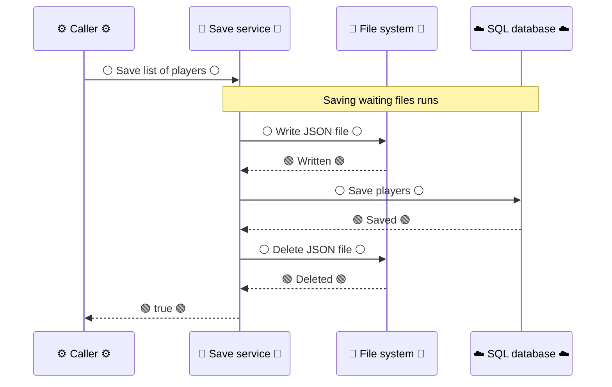

#### 2. The save fails

Like 1, but the players can't be saved: the file stays and a report is sent. `false` is returned.

1. New player data is received.
2. The subflow [Saving waiting files](#saving-waiting-files) runs.
3. A JSON file with the players and the current time is written.
4. The players and the time are saved together. This fails, so neither is saved.
5. The JSON file stays and waits.
6. A report says the save failed.
7. The save returns `false`.

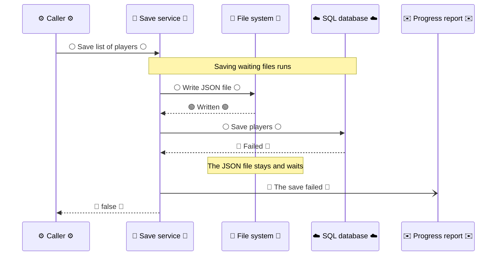

#### 3. The file can't be written, the save works

Like 1, but the JSON file can't be written: a report is sent, and the save goes on without the file. `true` is returned.

1. New player data is received.
2. The subflow [Saving waiting files](#saving-waiting-files) runs.
3. Writing the JSON file fails.
4. A report says the file could not be written.
5. The players and the time are saved anyway, because the file is only a backup.
6. The save returns `true`.

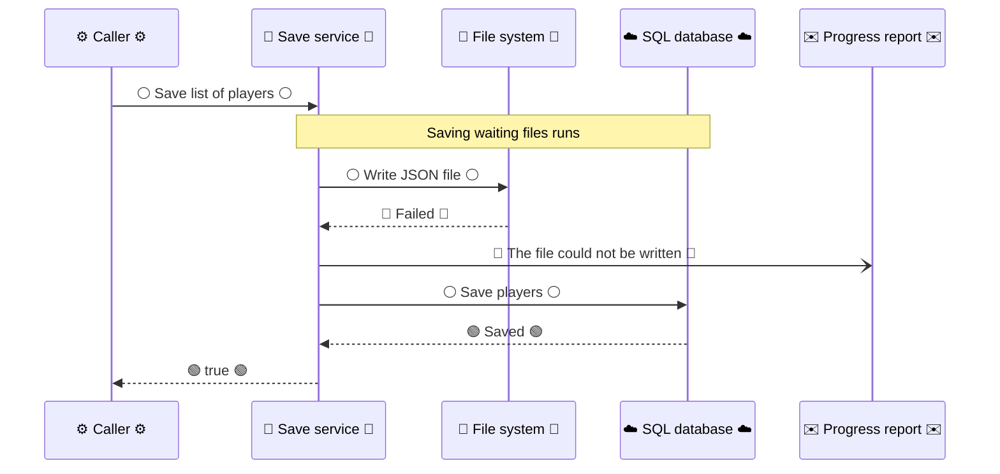

#### 4. The file can't be written, the save fails too

Like 3, but the save fails as well: a second report is sent. `false` is returned.

1. New player data is received.
2. The subflow [Saving waiting files](#saving-waiting-files) runs.
3. Writing the JSON file fails, and a report says so.
4. The players and the time are saved anyway. This fails.
5. A report says the save failed.
6. The save returns `false`.

Nothing is kept by the save. In this application the Caller still has the players. When it keeps them, the save can be tried again.

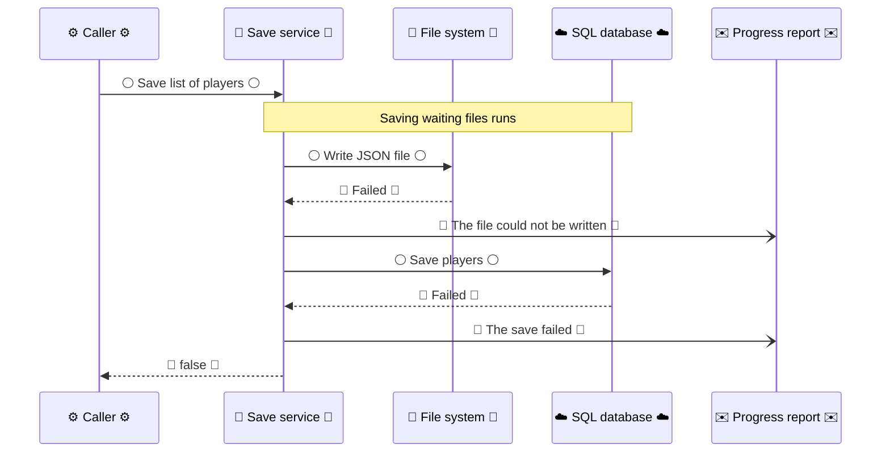

#### 5. The file isn't deleted after a successful save

Like 1, but the JSON file can't be deleted: a report is sent. `true` is returned.

1. New player data is received.
2. The subflow [Saving waiting files](#saving-waiting-files) runs.
3. A JSON file with the players and the current time is written.
4. The players and the time are saved together.
5. Deleting the JSON file fails, and a report says so.
6. The save returns `true`.

The file stays and waits. At the next call it is saved again, which changes nothing, because a save updates rows that already exist. Then it is deleted.

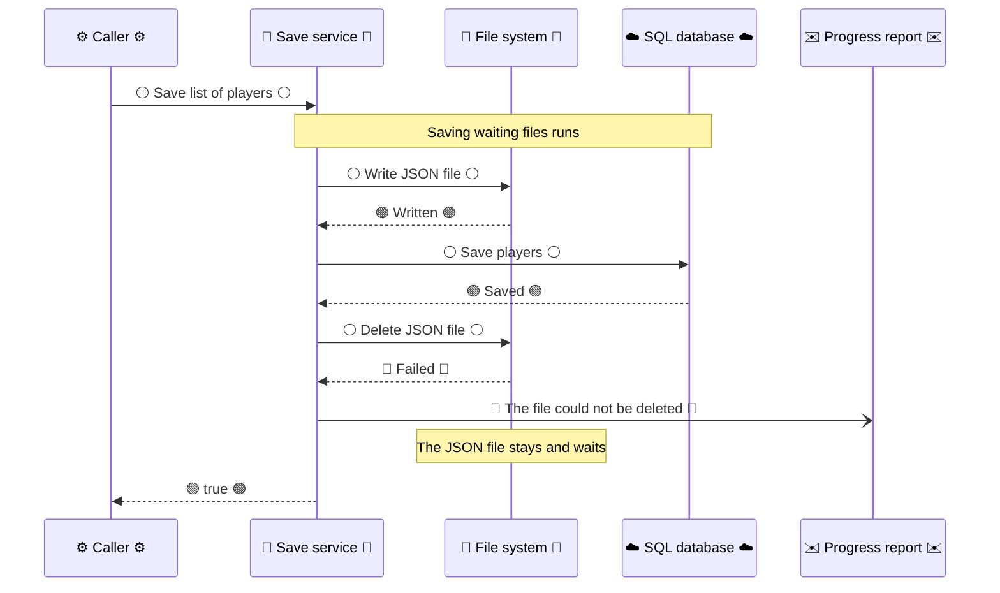

### Reading limited-call data

#### 1. Happy path

Nothing is waiting, and the read works.

1. Get players comes in.
2. The subflow [Saving waiting files](#saving-waiting-files) runs. Nothing is waiting.
3. The read is sent to the SQL database. It answers.
4. The answer is returned.

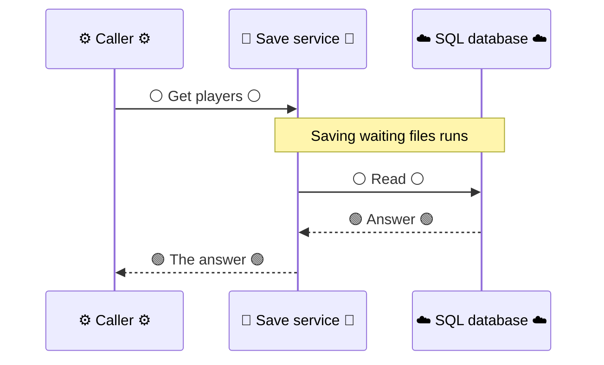

#### 2. A read fails

Like 1, but the read fails: a report is sent. `null` is returned.

1. Get players comes in.
2. The subflow [Saving waiting files](#saving-waiting-files) runs. Nothing is waiting.
3. The read is sent to the SQL database. It fails.
4. A report says the read failed.
5. The read returns `null`.

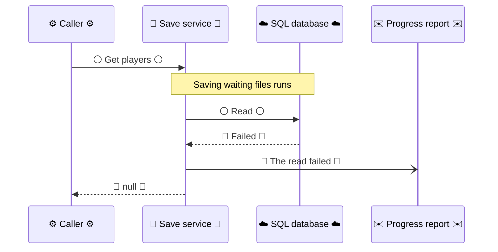

#### 3. A read fails, files were saved first

Like 2, but files were waiting, so the subflow read them: the data read from the last file processed (if any) is returned.

1. Get players comes in.
2. The subflow [Saving waiting files](#saving-waiting-files) runs. Files are waiting, so their data is read.
3. The read is sent to the SQL database. It fails.
4. A report says the read failed.
5. The data read from the last file processed (if any) is returned.

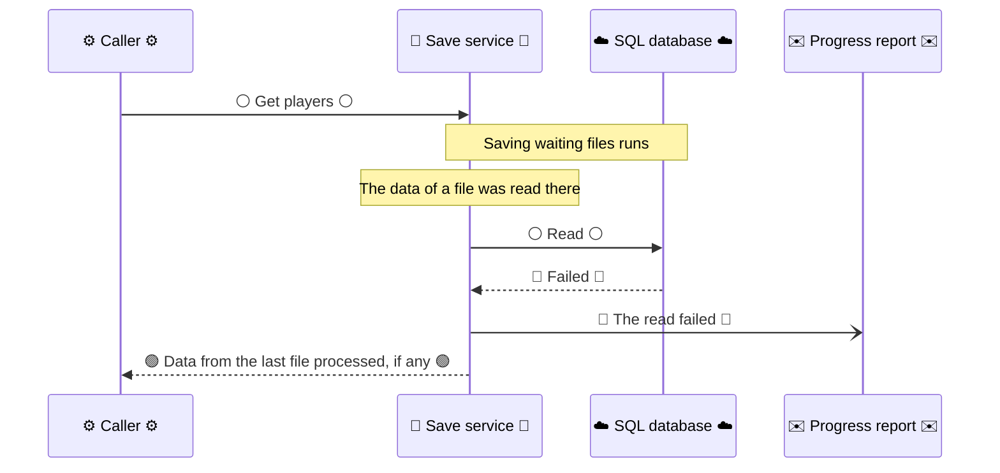

### Any other call

This call runs the subflow [Saving waiting files](#saving-waiting-files). The rest of what it does has nothing to do with limited-call data.

### Saving waiting files

This subflow runs before every call, whenever waiting JSON files are found, one or more. It saves them into the SQL database, oldest first, so the newest data is saved last. Each file is deleted after it is saved.

#### 1. Happy path

Files are waiting, and the save works.

1. Waiting JSON files are found. They are not read yet.
2. A `SELECT 1` checks that the SQL database is up. It answers.
3. The oldest file is read.
4. Its players and time are saved together.
5. The file is deleted.
6. Steps 3 to 5 repeat for each next file.
7. A report says the files have been written.

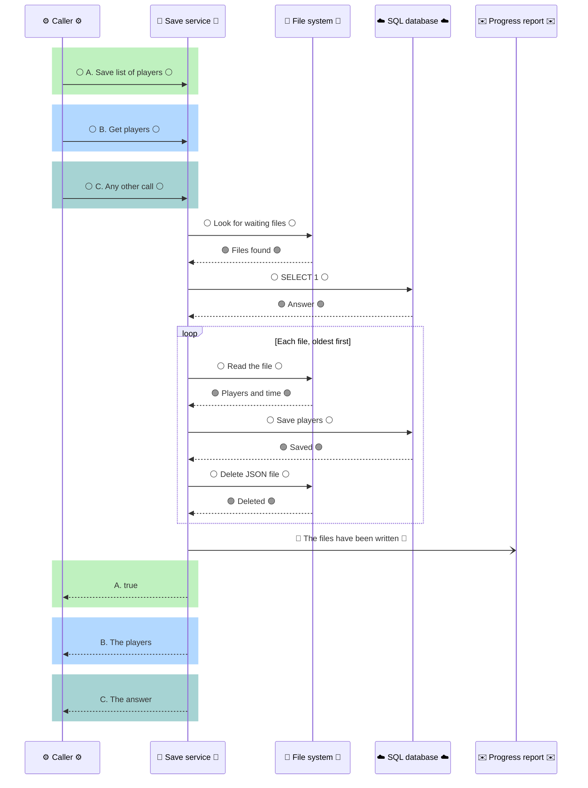

#### 2. Everything goes wrong

Like 1, but every step fails: each failure sends a report, the files stay, and the call goes ahead.

This is not a real flow. It shows all possible error messages at once. The flow tests have to be deduced from it.

The loop goes through the files oldest first and stops at the first failure. When a file was read before the failure, its data can be returned to Get players.

1. The `SELECT 1` fails: a report says the SQL database can't be reached.
2. The oldest file can't be read: a report says a found file is not saved yet, because it can't be read.
3. Saving the file fails: a report says a found file is not saved yet.
4. Deleting the file fails: a report says the file could not be deleted.

🛑 marks a point where an error can occur. The process stops there, and a value is returned.

"Depends" means the answer depends on what happens with the actual call:

- ¹ A depends on the new save after the loop: `true` when it is saved, `false` when it isn't.
- ² B depends on the read from the SQL database after the loop: the players when it works, `null` when it fails.
- ³ C depends on what the other call does after the loop. It gives its usual answer.

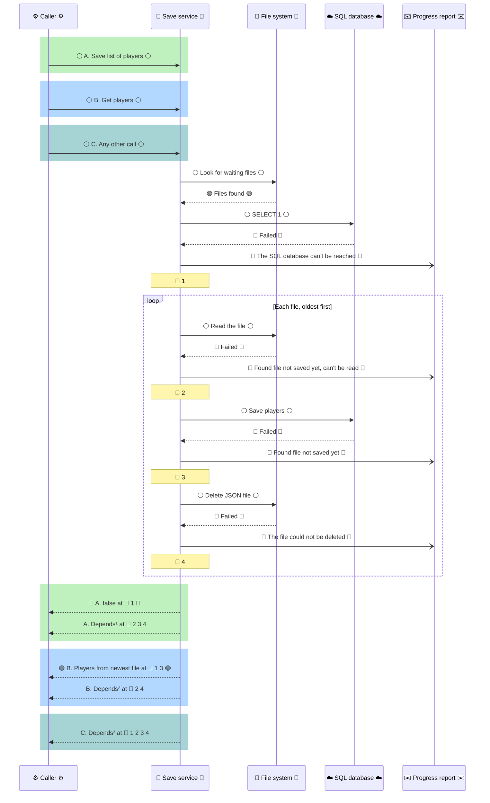

#### 3. No file is found

Like 1, but no file is found: there is no loop, and the call continues with whatever the command was.

1. Any call comes in.
2. Waiting JSON files are looked for. None are found.
3. The call continues with whatever the command was.

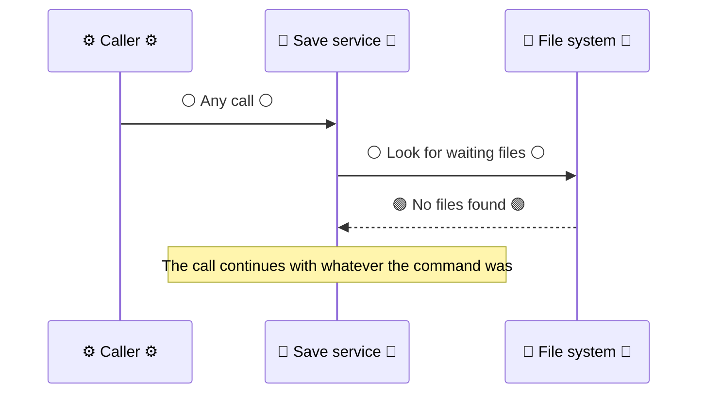

### Edge cases

#### Cancelled call

A cancel is passed on to the SQL database and to the file operations. The call acknowledges it by ending as cancelled (`OperationCanceledException`). This is the one case where an error is thrown to the caller, because a cancel is not a failure.

#### Timeout

When a save runs out of time, a message is sent and `false` is returned. The players save gets 5 minutes and is not retried.
