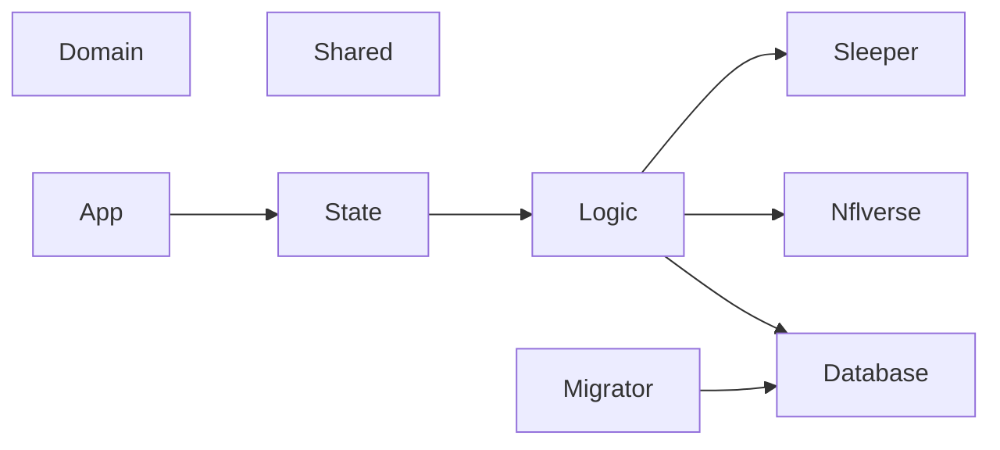

# FantasyInformator

A personal application to manage multiple fantasy football teams on [Sleeper](https://sleeper.com). It runs locally on a PC and keeps its data in an Azure SQL database.

[[_TOC_]]

## What it can do

- Keep several fantasy teams (Sleeper leagues) side by side, per season.
- Fetch league and roster information from Sleeper only when you ask for it.
- Show each league's roster: which player sits in which slot, and which slots each player could fill.
- Keep what it fetched separate from what is stored. You see what changed and decide what to save.
- Warn you when you leave with unsaved changes.

## Projects

Every functionality is a separate project. A project's README holds its details.

| Project | Purpose |
|---------|---------|
| [FantasyInformator.App](FantasyInformator.App/README.md) | Blazor front end. It tells State what to change. |
| [FantasyInformator.State](FantasyInformator.State/README.md) | Holds the data the app shows, changes it and marks what changed. |
| [FantasyInformator.Logic](FantasyInformator.Logic/README.md) | Fetches data from Sleeper and nflverse, reads and writes the database, and decides when to save. |
| [FantasyInformator.Domain](FantasyInformator.Domain/README.md) | The application models, known to every project |
| [FantasyInformator.Shared](FantasyInformator.Shared/README.md) | The application's own library of shared functionality, such as the progress reports every project uses to report errors and progress, and the mappers |
| [FantasyInformator.Tool.MapGenerator](Tools/FantasyInformator.Tool.MapGenerator/README.md) | Console app that writes the `.Map()` extension methods for every model into a project, just before it compiles |
| [FantasyInformator.Service.Sleeper](FantasyInformator.Service.Sleeper/README.md) | Retrieval from Sleeper |
| [FantasyInformator.Service.Nflverse](FantasyInformator.Service.Nflverse/README.md) | Kickoff times from nflverse |
| [FantasyInformator.Database](FantasyInformator.Database/README.md) | Code-first database |
| [FantasyInformator.Migrator](FantasyInformator.Migrator/README.md) | Creates and applies the database migrations |
| [FantasyInformator.Tests](Tests/FantasyInformator.Tests/README.md) | Tests of chosen flows through State and Logic, with stand-ins for Sleeper and the database |

A project with its own models (Sleeper, Nflverse, Database) holds the mappers between those models and Domain, so no other project needs to know its models.

Each project except Domain has a test project with the same name plus `.Tests`. Domain holds only models and no logic, so it has no tests. `FantasyInformator.Tests` holds tests of chosen flows through State and Logic, with stand-ins for Sleeper and the database. The tests use MSTest and AutoFixture.

## How the projects connect

An arrow points from a project to a project it uses.

Domain and Shared stand apart: most projects use them, so their arrows are left out.
